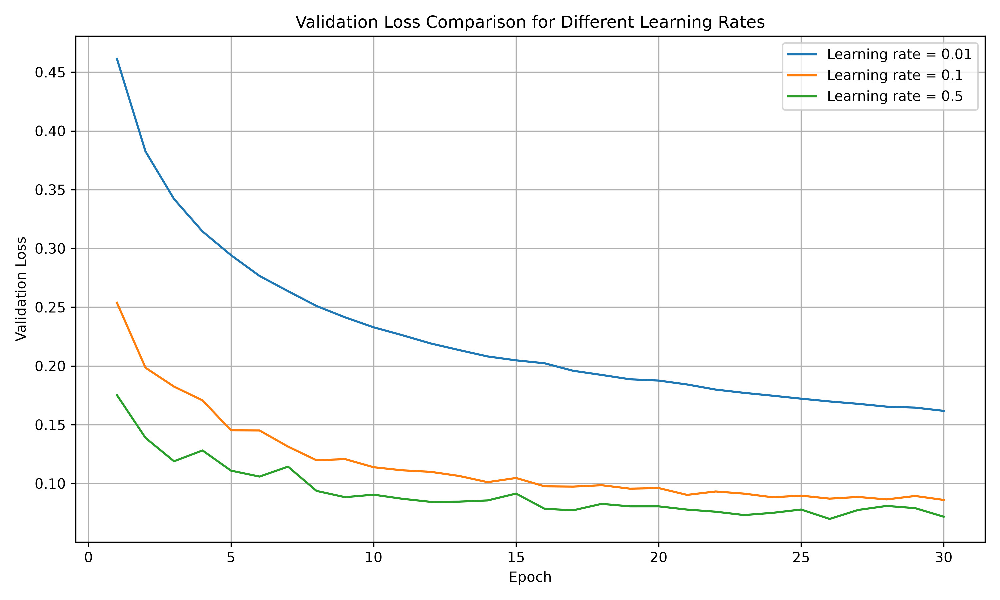
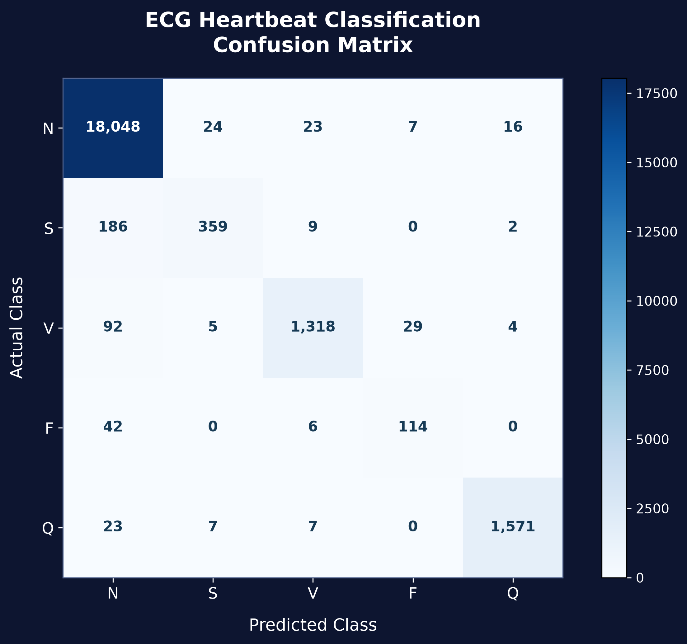
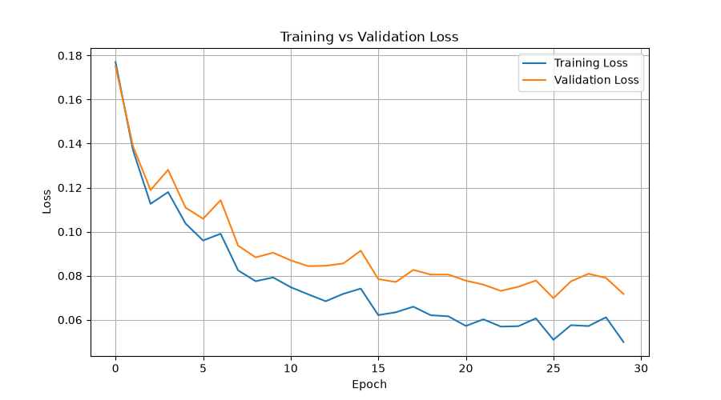
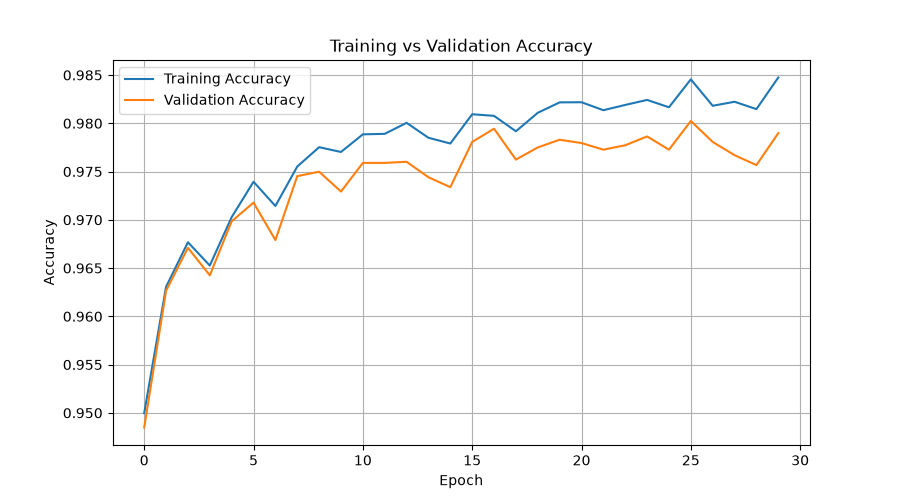
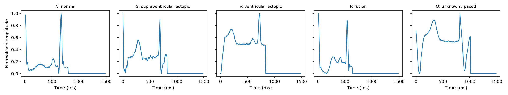

# NEUROCARD AI
### ECG Heartbeat Classification Using a Custom Neural Network

NEUROCARD AI is a deep learning project that classifies ECG heartbeat signals into five categories using a custom-built neural network implemented in PyTorch.

The project uses the MIT-BIH heartbeat dataset and includes data preprocessing, neural network implementation, gradient verification, model training, evaluation, and an interactive Streamlit frontend.

---

## 1. Project Overview

Electrocardiogram (ECG) signals provide important information about the electrical activity of the heart. This project aims to automatically classify heartbeat signals into five categories using a neural network.

### Objectives

- Load and prepare the MIT-BIH heartbeat dataset.
- Visualize representative ECG signals.
- Implement a neural network using PyTorch.
- Implement softmax cross-entropy loss.
- Verify gradients using numerical comparisons.
- Train the network using mini-batch gradient descent with momentum.
- Compare different learning rates.
- Evaluate the final model on unseen test data.
- Develop an interactive ECG classification interface.

---

## 2. Dataset

**Dataset:** MIT-BIH Heartbeat Dataset

Each ECG sample contains:

- 187 numerical signal features.
- 1 target class label.

### Dataset Dimensions

| Dataset | Samples |
|---|---:|
| Original Training Dataset | 87,554 |
| Training Set | 78,799 |
| Validation Set | 8,755 |
| Testing Set | 21,892 |

The original training dataset was divided into training and validation sets using a 90:10 split.

### Heartbeat Classes

| Label | Class | Description |
|---|---|---|
| N | Normal | Normal heartbeat |
| S | Supraventricular | Supraventricular ectopic beat |
| V | Ventricular | Ventricular ectopic beat |
| F | Fusion | Fusion beat |
| Q | Unknown | Unknown heartbeat class |

Signal values in the training dataset range from 0.0 to 1.0.

---

## 3. Neural Network Architecture

The project implements a fully connected neural network named **ECGNet**.

| Layer | Neurons | Activation |
|---|---:|---|
| Input Layer | 187 | None |
| Hidden Layer 1 | 128 | ReLU |
| Hidden Layer 2 | 64 | ReLU |
| Output Layer | 5 | Linear logits |

### Model Details

- Framework: PyTorch
- Initialization: He Initialization
- Loss Function: Custom Softmax Cross-Entropy
- Total Trainable Parameters: 32,645
- Output: Five heartbeat classes

The output layer produces logits, which are converted into class probabilities using softmax during prediction.

---

## 4. Training Configuration

| Parameter | Value |
|---|---:|
| Batch Size | 128 |
| Epochs | 30 |
| Momentum | 0.9 |
| Weight Decay | 0.0001 |
| Selected Learning Rate | 0.5 |
| Optimizer | Mini-batch Gradient Descent with Momentum |

### Gradient Verification

The manually calculated gradients were compared with PyTorch automatic differentiation.

| Parameter | Maximum Absolute Difference |
|---|---:|
| W3 | 5.96 × 10⁻⁸ |
| b3 | 1.19 × 10⁻⁷ |

These small differences demonstrate close agreement between the manual gradient calculations and automatic differentiation.

---

## 5. Learning Rate Comparison

Three learning rates were evaluated.

| Learning Rate | Lowest Validation Loss | Validation Accuracy at Best Epoch |
|---:|---:|---:|
| 0.01 | 0.161784 | 95.79% |
| 0.1 | 0.086000 | 97.64% |
| 0.5 | 0.069805 | 98.02% |

The learning rate of **0.5** achieved the lowest validation loss and was selected for final training.

### Learning Rate Comparison Graph



---

## 6. Final Test Results

The final trained model was evaluated on 21,892 unseen test samples.

| Metric | Result |
|---|---:|
| Total Test Samples | 21,892 |
| Correct Predictions | 21,410 |
| Incorrect Predictions | 482 |
| Test Accuracy | 97.80% |
| Balanced Accuracy | 84.65% |

### Class-Wise Accuracy

| Class | Accuracy |
|---|---:|
| N | 99.61% |
| S | 64.57% |
| V | 91.02% |
| F | 70.37% |
| Q | 97.70% |

### Confusion Matrix



### Training Loss



### Training Accuracy



### Sample ECG Signals



---

## 7. Interactive Streamlit Frontend

The project includes an interactive frontend developed using Streamlit.

### Features

- Space-themed AI dashboard.
- MIT-BIH test sample selection.
- CSV ECG signal upload.
- ECG waveform visualization.
- Actual model predictions.
- Five-class probability distribution.
- Model architecture information.
- Dataset overview.

The interface loads the trained PyTorch model from `results/best_model.pth`.

---

## 8. Project Structure

```text
Project_03/
│
├── app/
│   └── app.py
│
├── data/
│   ├── mitbih_train.csv
│   └── mitbih_test.csv
│
├── src/
│   ├── load_data.py
│   ├── prepare.py
│   ├── plot_beats.py
│   ├── model.py
│   ├── loss.py
│   ├── gradient_check.py
│   ├── train.py
│   ├── compare_lr.py
│   ├── final_training.py
│   ├── test_once.py
│   └── plot_confusion_matrix.py
│
├── results/
│   ├── best_model.pth
│   ├── example_beats.png
│   ├── learning_rate_comparison.png
│   ├── final_loss.png
│   ├── final_accuracy.png
│   ├── confusion_matrix.png
│   ├── analysis.md
│   └── results_tables.md
│
├── README.md
└── requirements.txt
```

---

## 9. Installation and Execution

### Step 1: Clone Repository

```bash
git clone YOUR_GITHUB_REPOSITORY_URL
cd Project_03
```

### Step 2: Create Virtual Environment

```bash
python -m venv .venv
```

Activate on macOS/Linux:

```bash
source .venv/bin/activate
```

Activate on Windows:

```bash
.venv\Scripts\activate
```

### Step 3: Install Dependencies

```bash
pip install -r requirements.txt
```

### Step 4: Run Streamlit Application

```bash
streamlit run app/app.py
```

---

## 10. Requirements

The project uses:

- Python
- PyTorch
- NumPy
- Pandas
- Matplotlib
- Streamlit

---

## 11. Experimental Analysis

Detailed experimental observations, model evaluation, confusion matrix analysis, and discussions are available in:

- `results/analysis.md`
- `results/results_tables.md`

---

## 12. Limitations

- The dataset contains imbalanced heartbeat classes.
- Minority classes have lower classification accuracy than the Normal class.
- The model is an academic machine learning prototype.
- Predictions should not be used as a substitute for professional medical diagnosis.

---


## 13. Contributors

This project was collaboratively developed by:

### 1. Mirza Abdul Rehman
- GitHub: [@mirzaabdulrehmanieee-xyz](https://github.com/mirzaabdulrehmanieee-xyz)

### 2. Muhammad Wasiq Aslam
- GitHub: [@mwa-1214](https://github.com/mwa-1214)

Both contributors collaborated on the design, implementation, experimentation, evaluation, and documentation of the ECG heartbeat classification project.


---

## 14. Acknowledgment

The project uses the MIT-BIH heartbeat dataset for ECG signal classification research and experimentation.

---

**NEUROCARD AI — ECG Heartbeat Classification Using PyTorch**
